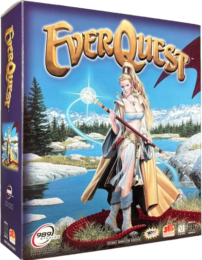

Welcome to EQResearch.info.  This site is dedicated to hosting research on how the
EverQuest MMORPG used to look, feel and behave in the oldest eras.  This site was created by and is
managed by **Torven** of the EQ Emulator community and is largely an archive of his work.
For more details regarding the purpose and history of this site and author, check
the [About](/about/) page.

_(This site is brand new and thus very empty.  Expect many updates)_

The TLDR; of this site is that MMORPGs evolve over time and many people prefer to
play the earlier eras of the game.  Daybreak however does not provide servers
with earlier era gameplay, and so superfans with technical know-how took up the job
of making them which is why emulated servers exist.  Since MMORPGs are client-server 
games, it's impossible to be 100% precise in a recreation as it is for single player
games.  A lot of detective work is necessary to come up with reasonably accurate
approximations of certain mechanics and details.

This site is intended to be a kind of server agnostic blueprint to create a classic EverQuest
server, with a focus on the more obscure details not found on sites like Allakhazam.
The scope will be on the earlier eras of the game (PoP and earlier) however I am
open to broadening this to later eras in a collaboration if other researchers
want to join forces and need a place to put it.
